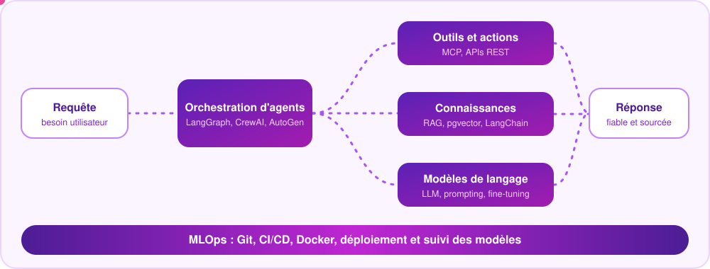

  
  
  
  
  
  

  
  
  

<h2 align="center">À propos</h2>

Je suis **ingénieure en informatique, spécialité Data Science et Intelligence Artificielle**. Je conçois et j’industrialise des **agents IA**, des solutions **RAG** et des workflows agentiques, avec une **expertise en développement web full stack** pour les intégrer dans de vrais produits.

Ma force : associer une solide culture **mathématique** à l’**informatique** pour livrer des solutions fiables, expliquables et prêtes à être exploitées, du modèle jusqu’à l’interface utilisateur.

 

<table>
<tr>
<td width="33%" valign="top">

### 🤖 Agents IA et LLM
- Systèmes multi-agents et architectures agentiques
- RAG et bases vectorielles (pgvector)
- MCP pour connecter agents et outils
- LangChain, LangGraph, AutoGen, CrewAI, Semantic Kernel
- Prompt engineering et fine-tuning

</td>
<td width="33%" valign="top">

### ⚙️ MLOps et industrialisation
- CI/CD avec GitLab et Azure DevOps
- Docker et microservices
- APIs REST avec Flask
- Versionnement avec Git et GitHub
- Méthodes agiles, Scrum

</td>
<td width="33%" valign="top">

### 📊 ML et data science
- Machine Learning et Deep Learning
- Scikit-learn, TensorFlow, Keras, PyTorch
- Vision par ordinateur, recommandation
- ETL, Spark, PySpark, Power BI
- Matplotlib et Seaborn

</td>
</tr>
<tr>
<td valign="top">

### 💻 Développement full stack
- Python, JavaScript, TypeScript, Java
- Spring Boot, Angular, Node.js
- PostgreSQL, MySQL, MongoDB, Oracle

</td>
<td valign="top">

### 🧠 NLP et connaissances
- Traitement du langage naturel
- Chatbots intelligents
- Gestion de connaissances

</td>
<td valign="top">

### 📐 Mathématiques × Informatique
- Fondements des modèles
- NumPy et SciPy
- Évaluation rigoureuse des résultats

</td>
</tr>
</table>

<h2 align="center">Architecture d’un système agentique</h2>

  

<i>Les agents orchestrent des outils (MCP, APIs), s’appuient sur une base de connaissances (RAG) et un LLM, le tout livré et suivi avec des pratiques MLOps.</i>

<h2 align="center">Mathématiques × Informatique</h2>

  

<h2 align="center">Compétences techniques</h2>

  

<h2 align="center">De la donnée au produit</h2>

  

<i>Je prends en charge la chaîne complète : préparer les données, entraîner et adapter les modèles, les déployer et les intégrer dans une application.</i>

<h2 align="center">Ce que j’apporte</h2>

| | |
|---|---|
| 🤖 **Des agents utiles, pas des démos** | Je transforme un besoin métier en solution IA exploitable : agents, RAG et outils connectés via MCP. |
| ⚙️ **Un livrable durable** | MLOps, CI/CD et conteneurisation pour des résultats reproductibles, déployables et maintenables. |
| 📐 **Un regard mathématique** | Je choisis, valide et justifie un modèle plutôt que de l’utiliser en boîte noire. |
| 🔗 **Du modèle à l’interface** | Mon profil full stack permet d’intégrer l’IA dans de vraies applications web. |
| 📊 **Des résultats lisibles** | Matplotlib, Seaborn et Power BI pour expliquer clairement ce que disent les données, aux équipes techniques comme métiers. |

<h2 align="center">Certifications</h2>

| Certification | Date |
|---|---|
| Generative AI and LLMs: Architecture and Data Preparation (IBM) | 04/2026 |
| AWS Data Engineering | 11/2025 |
| OCI AI Foundations (Oracle) | 10/2025 |
| Python for Data Science, AI & Development (IBM) | 03/2025 |
| Data Analysis with Python (IBM) | 03/2025 |
| Data Visualization with Python (IBM) | 03/2025 |

  
  
  

<h2 align="center">GitHub en chiffres</h2>

  
  

<h2 align="center">Parlons-en</h2>

  Je suis ouverte aux opportunités en <b>agents IA</b>, <b>RAG</b>, <b>MLOps</b> et <b>développement full stack</b>. 
  Écris-moi sur <a href="https://www.linkedin.com/in/salma-lamouchi-148451230/">LinkedIn</a> ou par <a href="mailto:salmalamouchi19@gmail.com">email</a>.

