  
  
  
  

  
  
  

<h2 align="center">À propos</h2>

Je suis **ingénieure junior en Data Science et Intelligence Artificielle**, avec une **expertise en développement web full stack**.

Ma force : associer une solide culture **mathématique** à l’**informatique** pour concevoir des solutions fiables, expliquables et bien intégrées, du modèle jusqu’à l’interface utilisateur. Je cherche des missions où la rigueur scientifique rencontre l’exigence d’un produit livré.

 

<table>
<tr>
<td width="33%" valign="top">

### 🧠 Data Science et IA
- Machine Learning et Deep Learning
- Fine-tuning de modèles
- MLOps
- LLM et RAG
- Visualisation de données

</td>
<td width="33%" valign="top">

### 💻 Développement full stack
- Backend Java et Spring Boot
- Frontend Angular
- JavaScript
- Python pour la donnée et l’IA

</td>
<td width="33%" valign="top">

### 📐 Mathématiques × Informatique
- Fondements des modèles
- Calcul scientifique, NumPy et SciPy
- Évaluation rigoureuse des résultats
- Résultats lisibles et argumentés

</td>
</tr>
</table>

<h2 align="center">Mathématiques × Informatique</h2>

  

<h2 align="center">Compétences techniques</h2>

  

  

  

  

<h2 align="center">De la donnée au produit</h2>

  

<i>Je prends en charge la chaîne complète : préparer les données, entraîner et adapter les modèles, les déployer et les intégrer dans une application.</i>

<h2 align="center">Ce que j’apporte</h2>

| | |
|---|---|
| 📐 **Un regard mathématique** | Je choisis, valide et justifie un modèle plutôt que de l’utiliser en boîte noire. |
| 🔗 **Du modèle à l’interface** | Mes solutions d’IA s’intègrent dans de vraies applications web grâce à mon profil full stack. |
| ⚙️ **Un livrable durable** | Fine-tuning, MLOps et bonnes pratiques d’ingénierie pour des résultats reproductibles et maintenables. |
| 📊 **Des résultats lisibles** | Matplotlib et Seaborn pour expliquer clairement ce que disent les données. |

<h2 align="center">GitHub en chiffres</h2>

  
  

<h2 align="center">Parlons-en</h2>

  Je suis ouverte aux opportunités en <b>Data Science</b>, <b>IA</b> et <b>développement full stack</b>. 
  Écris-moi sur <a href="https://linkedin.com/in/TON-PROFIL">LinkedIn</a> ou par <a href="mailto:ton.email@exemple.com">email</a>.

